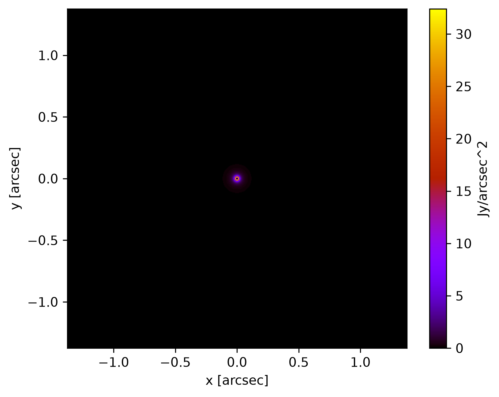
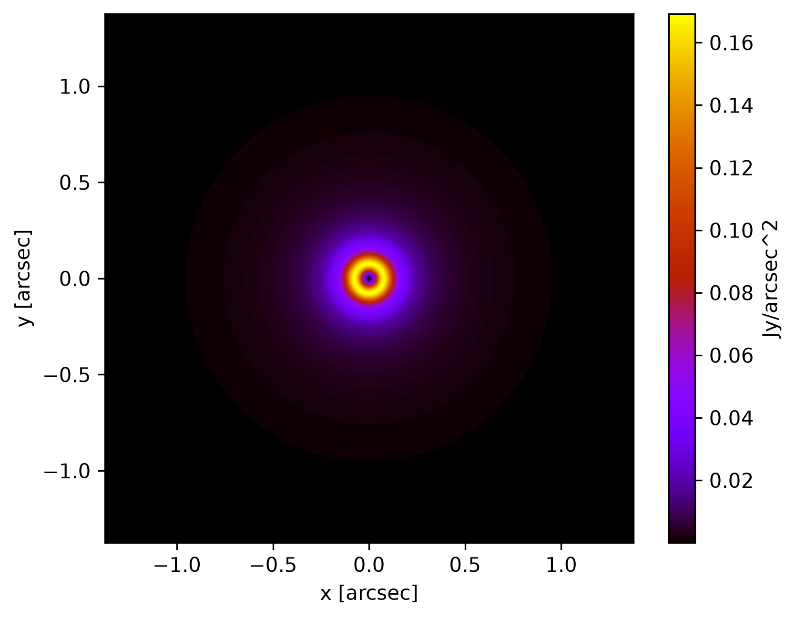
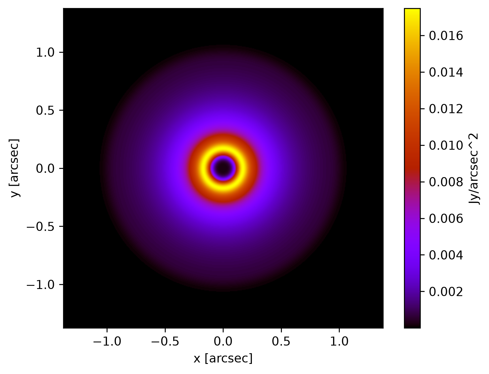
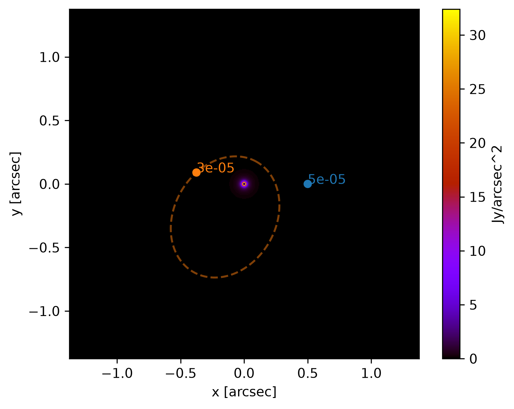
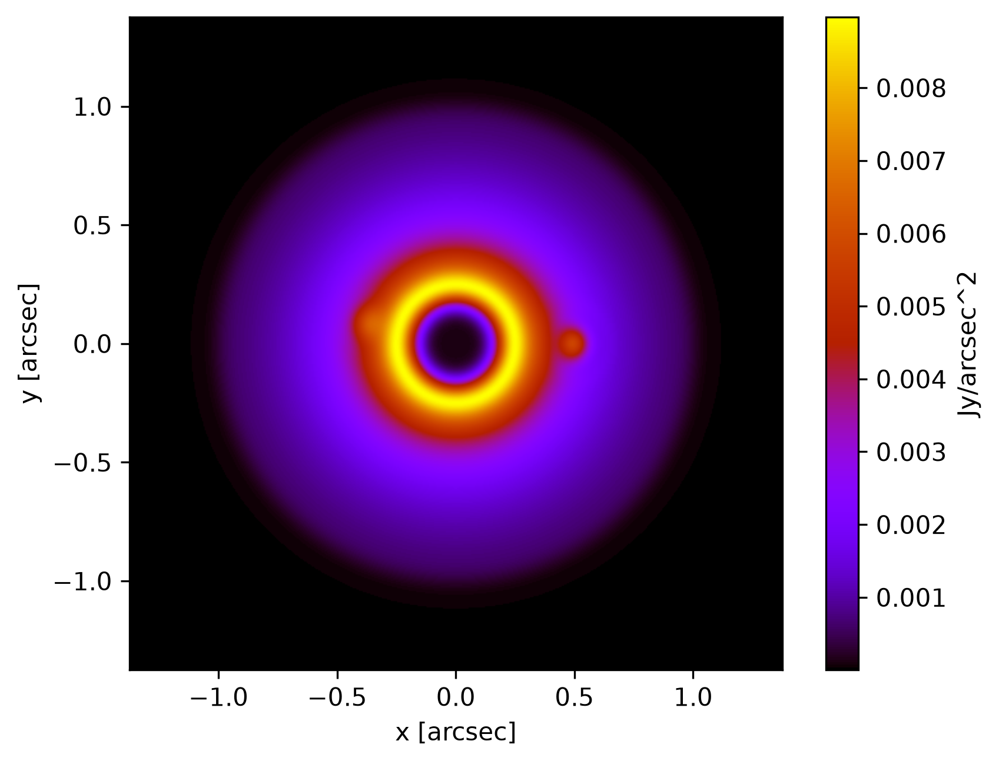
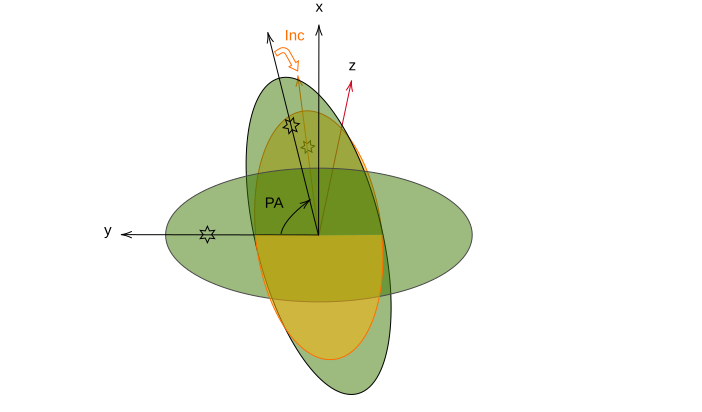
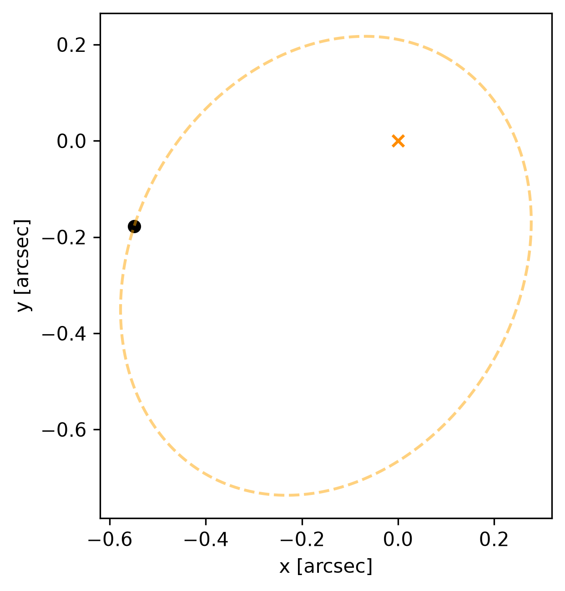
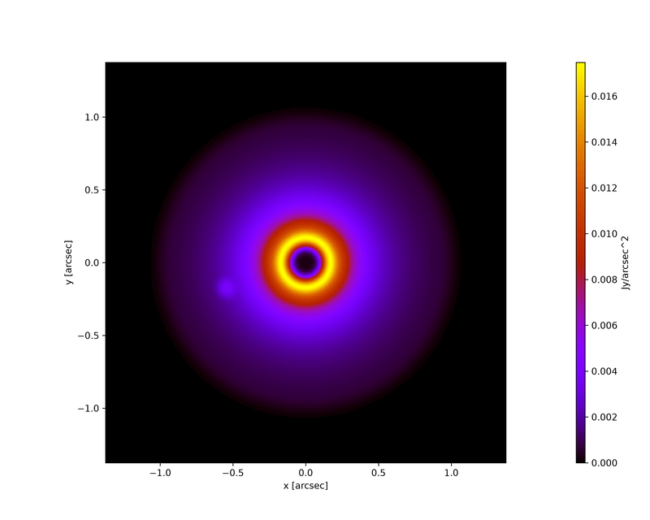
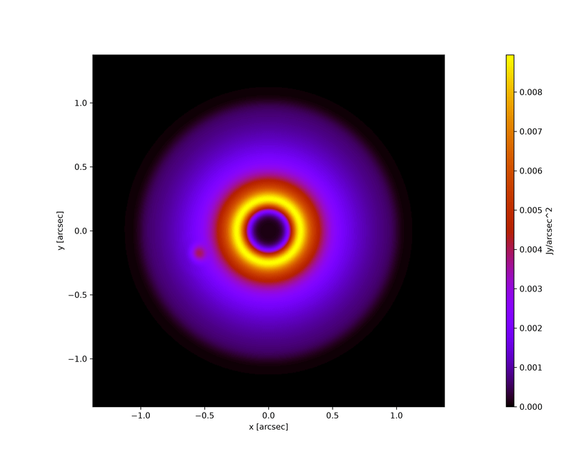

<!-- Badges in rainbow order, red to violet. Two keep their own colours, in the places their colours fit:
     Coverage (its colour shows the value; tests/make_badges.py sets it) in the green place, and DOI
     (Zenodo's badge, always its latest DOI) in the blue place. The others read PyPI / GitHub through shields.io. -->
[](https://github.com/dreamjade/Toy_Coronagraph/blob/main/toycoronagraph/__init__.py)
<a href="https://pypi.org/project/toycoronagraph/"></a>
[](https://github.com/dreamjade/Toy_Coronagraph/tree/main/tests)
[](https://github.com/dreamjade/Toy_Coronagraph/tree/main/tests/unit)
[](https://dreamjade.github.io/Toy_Coronagraph/index.html)
<a href="./LICENSE"></a>
[](https://zenodo.org/badge/latestdoi/665310914)
[](https://github.com/dreamjade/Toy_Coronagraph.git)
[](https://github.com/dreamjade/Toy_Coronagraph/tree/main/requirements.txt)

# Toy Coronagraph
<p align="center">

</p>

The toycoronagraph package is implemented in Python

Language | Release | Note
---------- | -------- | ------
Python | [On PyPI](https://pypi.python.org/pypi/toycoronagraph) | though not always the most recent [version](./toycoronagraph/__init__.py)

for simulating coronagraphs. It is designed to be simple and easy to use, while still providing a powerful and flexible framework for simulating a variety of coronagraph designs. 

The package includes a number of pre-defined coronagraph designs, as well as a library of functions for creating custom coronagraphs. It also includes a number of tools for visualizing the results of simulations, such as ray tracing plots and intensity maps.

The toycoronagraph package is open source and available on GitHub. It is a valuable tool for anyone interested in learning about coronagraphs or simulating the performance of coronagraph designs.

### Here are some of the features of this package:

* Simple and easy to use
* Powerful and flexible framework
* Pre-defined coronagraph designs
* Library of functions for creating custom coronagraphs
* Tools for visualizing the results of simulations
* Open source and available on GitHub

### Here are some of the applications of this package:

* Learning about coronagraphs
* Simulating the performance of coronagraph designs
* Designing new coronagraph designs
* Testing the performance of coronagraph hardware
* Studying the physics of light scattering

### Example

example target           |  Final image (Charge=2)  |  Final image (Charge=6)
:-------------------------:|:-------------------------:|:-------------------------:
 |  | 

#### with planets

Pre-image  |  Final image (Charge=6)
:-------------------------:|:-------------------------:
 | 

#### Turn on/off dust inside IWA

Final image (Charge=6)  |  Final image but ignored dust inside IWA (Charge=6)
:-------------------------:|:-------------------------:
 | 

#### Moving planet on an elliptic orbit

Frame definition
:-------------------------:


Plot the orbit (time = 0.2 period, starting from the perihelion and moving counter-clockwise in the figure)
:-------------------------:


##### User could even make a video now

Video (Charge=6)  |  Video but ignored dust inside IWA (Charge=6)
:-------------------------:|:-------------------------:
 | 

### Installation
```bash
pip install toycoronagraph
```
* It needs Python 3.11 or newer, and installs its requirements (`requirements.txt`: numpy, scipy, matplotlib, astropy, hcipy, scikit-image, joblib, tqdm).
* Videos (`planet_video`, `observe.video`) need the `ffmpeg` program with libvpx-vp9, e.g. `brew install ffmpeg` or `conda install -c conda-forge ffmpeg`.
* The Lazuli PSFs (`type = "lazuli"`) need prysm and the UASAL configuration packages, installed from GitHub: see [Lazuli PSFs](#lazuli-psfs-prysm).
* The spatial method can use a GPU (`[compute] use_gpu = true`) with CuPy installed for your CUDA version.
* For the examples and tests, clone the repository and install it in editable mode with the test tools: `pip install -e ".[test]"`. The bundled MCFOST model series (`toycoronagraph/example_data/`) comes only with the repository; the PyPI package has `example.fits`.
* The [documentation](https://dreamjade.github.io/Toy_Coronagraph/index.html) is made from the docstrings (Sphinx): `pip install -e ".[docs]"`, then `python docs/make_docs.py` rebuilds `docs/` (served by GitHub Pages) from `docs/source/`.

### Example usage (Python)
This [py file](./tests/test.py) illustrates how the Python package is used.
```Python
import toycoronagraph.main as toy

# Load the example target image (example.fits) in Toy_Coronagraph/toycoronagraph/example_data/ folder
toy_target = toy.Target()

# Plot the preimage; the image will auto-save to origin.png
toy_target.plot_origin()

# Plot the final image through vortex coronagraph with charge = 2; the image will auto-save to charge2_final.png
toy_target.plot_final(charge=2)

# Plot the final image through vortex coronagraph with charge = 6; the image will auto-save to charge6_final.png
toy_target.plot_final(charge=6)

# Or save under your own name: "name" or "folder/name" (the folder is created; the format follows the extension)
toy_target.plot_origin(file_name="example_input.png")
toy_target.plot_final(charge=6, file_name="results/example_charge6.pdf")

# Now add a static planet, where pos=(x_position, y_position) in arcsec from the star: +x to the right,
# +y up (y increases with the image row, as in FITS/DS9 and in scenes)
toy_target.add_planet(pos=[0.5,0], brightness=0.00005, mode="cartesian")

# You could also add a moving planet on an elliptic orbit, where pos=(length of the semi-major axis, eccentricity, position angle, inclination angle, time/period))
toy_target.add_planet(pos=[0.5,0.6,60,0,0.1], brightness=0.00003, mode="moving")

# Plot the preimage with planets; the image will auto-save to origin_with_planets.png
toy_target.plot_origin()

# Plot the final image with planets; the image will auto-save to charge6_with_planets_final.png
toy_target.plot_final(charge=6)

# Plot the final image by turning off the target inside IWA; the image will auto-save to charge6_with_planets_iwa_ignore_final.png
toy_target.plot_final(charge=6, iwa_ignore=True)

# List the planets
toy_target.list_planets()
'''
Static Planet 1: (0.5, 0.0) arcsec, brightness: 5.00e-05 Jy
Moving Planet 2: (-0.3818058424930897, 0.08394161212137384) arcsec, brightness: 3.00e-05 Jy
'''

# Delete a specific planet
toy_target.delete_planet(order=1)
'''
Successfully remove planet #1, here is the latest planet list:
Moving Planet 1: (-0.3818058424930897, 0.08394161212137384) arcsec, brightness: 3.00e-05 Jy
'''

# Move a moving planet on its orbit by time/period=0.1
toy_target.planet_move(time=0.1, order=1)
'''
Planet has moved to new position
'''

# Plot the orbit of a specific moving planet; the image will auto-save to oribit_planet#.png
toy_target.plot_orbit(order=1)

# Plot the new preimage with planets; the image will auto-save to origin_with_planets.png
toy_target.plot_origin()

# Plot the new final image with planets; the image will auto-save to charge6_with_planets_final.png
toy_target.plot_final(charge=6)

# Print a specific planet brightness, background brightness, and background brightness (ignored dust inside IWA) in the final image through vortex coronagraph with charge = 6
toy_target.contrast(charge=6, order=1)
'''
This is a charge-6 vortex coronagraph.
'''

# Plot the core_throughput and inner working angle (in pixel)
import toycoronagraph.psf as psf
psfs = toy_target.radial_psfs(charge=2)  # the radial PSFs (computed once, cached in psf_cache_dir)
psf.cir_core_throughput_plot(psfs)

# Make the planet movie
toy_target.planet_video(charge=6)
# The video will be save to planet_video.webm

# Make the planet movie again, but ignore the dust inside IWA
toy_target.planet_video(charge=6, iwa_ignore=True)
# The video will be save to planet_video_iwa_ignore.webm

# Which method is used? "auto" uses the circular method when the target and the PSFs are both
# circularly symmetric, and the spatial method otherwise
toy_target.check_symmetry()
'''
Method: circular (auto; target symmetric: asymmetry 0.13%, light in the corners 0% (tol 1%); PSFs symmetric: vortex model)
'''

# The spatial method works for any target (or set method = "spatial" in the parameter file);
# it prints the kernel size chosen for [method] error_target, an error analysis per stage, and the
# estimated error of each image; saved to charge6_with_planets_spatial_final.png
toy_target.plot_final(charge=6, method="spatial")
```

### Circular and spatial methods
* **Circular** (the original method): reads the target's radial profile and rotates the PSFs of sources along one axis around the star. It is exact only for a target *and* PSFs that are circularly symmetric about the star; with the extended radial PSF frames it matches a brute-force image to ~1e-4. The radial PSFs reach the image's edge; the light beyond, out to the corners, uses the last one shifted outwards (far from the star a PSF no longer changes with the source's position).
* **Spatial**: convolves every pixel of the target with its own PSF (blended from PSFs sampled on a grid that is densest where the PSF shape changes fastest; every pixel near the star gets its exact PSF). It works for any target. The kernel size and the grid are chosen from `[method] error_target`, and each run prints an error analysis per stage and the estimated error of the image. For rotationally symmetric optics (the vortex) the sampled PSFs are interpolated from the radial PSFs (`spatial_mode = "rotate"`, fast); otherwise each is propagated directly (`"direct"`).
* `method = "auto"` (the default) uses the circular method when the target is circularly symmetric (`[target] symmetric`, measured unless set) and the PSFs are (`[coronagraph] symmetric`, from the optics model unless set), and the spatial method otherwise. `Target.check_symmetry()` shows the choice and why; `method=` in `plot_final`, `contrast` and `planet_video` overrides it. Computed PSFs are cached in `[compute] psf_cache_dir` under names that record the optics and sampling. So are the spatial method's built models (`model_*.npz`, up to about 2 GB each): a model file stores everything it was made from (the optics in full, mode, kernel size, error target, the radial PSF file and the code that builds it) and is used only if all of it is the same, so a new session loads it in about a second instead of rebuilding it. Delete cache files at any time; they are made again when needed.
More instructions could be found in [docs](https://dreamjade.github.io/Toy_Coronagraph/index.html).

### Parameters and your own target
Parameters are read from `toycoronagraph_para.toml` in the working directory; if it does not exist, a minimal one is created (the example image + a charge-2 vortex). Each quantity is set in **one** place:

| Section | Holds | Main keys |
|---|---|---|
| `[observation]` | the observation | `wavelength` (`"auto"`: from the image header), `diameter` |
| `[grid]` | the simulated image | `size`, `pixel_scale` (`"auto"`: from the image), or `sampling` + `fov`; `resample` |
| `[star]` | the star | `distance`, `radius`, `temperature` / `flux_jy`, only when a module needs them |
| `[[source]]` | one table per input module | `kind` + that module's own keys |
| `[[coronagraph]]` | one table per coronagraph | `type` (`"vortex"`, or `"lazuli"`: see [Lazuli PSFs](#lazuli-psfs-prysm)), `charge`, `lyot_mask_size` |
| `[method]`, `[compute]` | method and computing | `method`, `error_target`, `num_cores`, `psf_cache_dir` |

* `python -m toycoronagraph new --sources fits_image --coronagraphs vortex:2,vortex:6` writes a file with only the chosen modules. Unused keys are flagged, and misspelled keys get a "did you mean".
* Generated files start with `#:schema ./toycoronagraph.schema.json`. In VS Code with *Even Better TOML*, hovering a key shows its description, unit and default, and mistakes are underlined. `python -m toycoronagraph describe KEY` explains any key, section or module, and `python -m toycoronagraph reference` prints every parameter.
* **One grid for everything.** By default the grid is the first image's own grid (`[grid] size` and `pixel_scale` = `"auto"`), so that image is used as it is. Modules that compute their image (wind, planets, your own) draw directly on the grid. Other images are put on it, conserving the flux, and a note says so. An image covering the grid's field (`pixel_scale` x `size`) at another resolution is rebinned. One covering another field is cropped, padded or rescaled, or, with `[grid] resample = false`, stops the run with an error listing each one. For a resolution study set only `[grid] size`: the image's field is kept and the pixel scale follows.
* Contradictions (e.g. two different distances) are errors that name each value and where it came from.
* The parameter file is never modified: the values actually used are saved to `toycoronagraph_para_used.toml`.
* Old files (`[target]`, `[telescope]`, ...) are still read; `python -m toycoronagraph migrate old.toml` rewrites them.

To simulate your own target:
* **An MCFOST image** (e.g. `data_0.6/RT.fits.gz`): a `[[source]]` with `kind = "mcfost"`. `component` picks the plane: `"disk"` (default; total minus the direct starlight), `"scattered_star"`, `"Q"`, `"direct_thermal"`, ... Avoid `"total"`, which includes the star itself. `inclination` and `azimuth` are indices. The unit, pixel scale and wavelength come from its header.
* **Any other image**: `kind = "fits_image"`. Save a FITS file with a square 2-D array (or a cube, and pick the plane with `slice`), the star at the centre of the array (pixel (N-1)/2, 0-based), and the header keywords `BUNIT` (`W/m^2/pixel`, `Jy/arcsec^2` or `Jy/pixel`), `PIXSCALE` (arcsec per pixel; or `CDELT1`/`CDELT2` in degrees) and `WAVELEN` (m). Without them, set `input_unit` in the source table and `[observation] wavelength` / `[grid] fov` instead.

```toml
[observation]
diameter = 6.5                 # m; wavelength and pixel scale come from the header

[[source]]
kind = "mcfost"
file = "data_0.6/RT.fits.gz"
component = "disk"

[[coronagraph]]
type = "vortex"
charge = 6
```

Saved images and videos of your own target start with its file name (e.g. `my_disk_charge6_final.png`), so they do not overwrite those of another target; the bundled example keeps the plain names (`charge6_final.png`, ...).

### Scenes: several inputs, several coronagraphs
A **scene** puts any number of input modules on one grid, and `observe()` sends them through any number of coronagraphs. The example is epsilon Eridani at 632 nm through Lazuli's 3.0 m aperture, with realistic values (`tests/test.ipynb` runs it, with an exozodiacal disk from a module of its own, and explains each figure):

```python
import numpy as np
from toycoronagraph.scene import Scene, Star
from toycoronagraph.sources.thomson import Wind
from toycoronagraph.sources.cme import Cme
from toycoronagraph.sources.planets import Planet
from toycoronagraph.observe import observe, video, Result

scene = Scene(star=Star(distance=3.22, radius=0.73),                     # pc, R_sun (temperature=: for Jy)
              wavelength=632e-9, diameter=3.0,                            # m
              sampling=5, fov=3.0)                                        # 5 px per lambda/D over 3.0": 345 px (odd)
scene.add(Wind(mdot=6e-13, v=400))                                        # M_sun/yr, km/s
scene.add(Cme(mass=1e17))                                                 # g
scene.add(Planet(mode="polar", pos=[1.09, 30], brightness=3e-9, brightness_unit="contrast"), name="eps_eri_b")
scene.plot(log=True, unit="contrast_pixel", axis="au")                    # the inputs

result = observe(scene, ["vortex:2", "vortex:6", {"type": "lazuli", "charge": 6}])
result.plot(unit="contrast_peak", components=["total"])                   # the coronagraphs side by side
result.plot(unit="contrast_peak", coronagraphs=["vortex_c6"])             # each component through one of them
result.plot_profiles(components=True, unit="contrast_peak", axis="au")    # dotted: each one's IWA
result.iwa("vortex_c6")                                                   # inner working angle, arcsec
result.plot_contributions()                                               # each input's share, pixel by pixel
image = result.final("vortex_c6", "wind", unit="contrast_peak")           # one final image, as an array
folder = result.save("results/eps_eri")                                   # a run folder (below)
again = Result.load(folder)                                               # plots and units, nothing computed again
```

* Each component goes through on its own (`[method] combine = "separate"`; `"together"` sums them first): the circular method when it and the PSFs are circularly symmetric (the wind), the spatial method otherwise (the CME), and the exact PSF for each planet. `components=[...]` observes some of them only.
* **Units** (`unit=`, or `[display] unit`): `"Jy/arcsec^2"`, `"Jy/pixel"`, `"contrast_pixel"` (each pixel's fraction of the star's flux) and `"contrast_peak"`, the usual coronagraph contrast: the surface brightness over the peak of the star's PSF through the same optics without the coronagraph's mask (the Lyot stop kept). Each coronagraph has its own peak (`result.peak_norms`: a 0.95 Lyot stop lowers it to 0.95⁴ of an ideal aperture's); input images use the ideal aperture's, π/4 (pixel / (λ/D))². A planet far from the star then reads about its contrast times the coronagraph's throughput there.
* **Plots**: every scene and result plot takes the same settings, `unit`, `log`, `log_range` (decades shown on a log scale; profiles show 3 more), `axis` and `dpi` (of a saved file), with `path=` to save it and `show=False` to keep it closed. A setting left out comes from `[display]` in the parameter file, so one line there changes every plot. Any other keyword goes to matplotlib: `imshow` for images (`cmap="magma"`), `plot` for curves (`lw=2`). Each plot returns its matplotlib figure, to change further. For a figure of your own, the data behind the plots are `result.final(...)`, `result.inputs`, `result.contributions(...)`, `result.iwa(...)` and `scene.radial_profile(image, result.grid)` (radius in arcsec, azimuthal mean).
* **Pixel sampling**: the vortex model (hcipy) samples its pupil from the image's pixels, so it needs at least 5 pixels per lambda/D for its PSFs' far wings to be right to about 1% near the image edge (5% too low at 2.4); below that a `SamplingWarning` names the pixel scale to use. Lazuli's PSFs have their own pupil sampling (`pupil_samples`, 512): about 13 samples per lambda/D of the image's half-width are enough, and fewer give the same warning. Lazuli's WCC detector pixels (0.0184″, 2.36 per lambda/D at 632 nm) are therefore too coarse for the vortex model: simulate at 5 per lambda/D and rebin afterwards if needed.
* **Inner working angle**: `result.iwa(name)` (arcsec) is where a point source keeps half of its light through the coronagraph, compared with far from the star (charge 2: 0.86 lambda/D, charge 4: 1.6, charge 6: 2.4); `None` for the telescope alone. `plot_profiles` marks it, and the run's FITS files keep it (`IWA`).
* **The star itself is not simulated** (neither its image nor its light leaking through the coronagraph): contrasts are fractions of the star's light, used as a unit.
* **A time series**: `video(scene, "vortex:6", "cme", [{"horizontal_height_factor": h} for h in np.linspace(0, 3, 20)], difference=True)` writes `cme_vortex_c6.webm` (lossless), the CME moving outwards. Only the CME is observed again for each frame (the others' final images are reused, the PSFs come from the caches), so a frame takes a fraction of a second. `difference=True` shows each frame minus the other components, like the base-difference images that reveal solar CMEs; without it a realistic CME is lost in the wind.

**Your own module** is a class declaring its parameters and drawing its image on the scene grid:

```python
from toycoronagraph.params import Param
from toycoronagraph.sources import Source, register_source
from toycoronagraph.units import SourceImage

@register_source
class Exozodi(Source):
    """A face-on exozodiacal dust disk."""
    kind = "exozodi"                          # its name in parameter files
    doc = "a face-on exozodiacal dust disk"
    family = "relative"                       # images as fractions of the star's light ("physical": Jy)
    requires = ("star.distance",)             # shared quantities it needs
    params = (Param("total", 2e-7, doc="the disk's light / the star's", min=0),
              Param("r_out", 3.0, unit="AU", doc="outer edge", min=0))

    def render(self, grid, star):             # the image on the scene grid
        r = np.hypot(*grid.coordinates())*star.distance      # au (1 arcsec at d pc = d au)
        disk = np.where(r <= self.settings["r_out"], np.maximum(r, 1e-9)**-2.34, 0.0)
        return SourceImage(self.settings["total"]*disk/disk.sum(), "contrast_pixel")

    def symmetric(self):                      # circularly symmetric: the circular method may be used
        return True

scene.add(Exozodi(total=1e-7))
```

In a parameter file it is a `[[source]]` with `kind = "exozodi"` and `module = "<the Python module defining it>"`. `tests/extra_sources.py` has longer templates (a ring with units, a CME blob).

**Files.** `result.save(folder)` writes a run folder:

| File | Holds |
|---|---|
| `scene.fits` | the inputs: one image extension per component (EXTNAME = its name, BUNIT, and a WCS of arcsec offsets from the star: CRPIX at pixel (N-1)/2, CDELT = the pixel scale); the grid, the star and STARFLUX (Jy) in the primary header; a POINTS table of the point sources |
| `<coronagraph>.fits` | its final images: FINAL_TOTAL and one FINAL_<COMPONENT> each (METHOD, MODE, ERRTYP: the estimated error); the optics, BUNIT, STARFLUX and PEAKNORM (the contrast_peak reference) in the primary header |
| `params_used.toml` | the parameters used, the coronagraphs included |
| `quicklook/` | `finals.png` and `contributions.png` |

`scene.write(path)` writes the inputs alone in the `scene.fits` format; `kind = "scene_fits"` reads such a file back as inputs (e.g. images made by another code). `[grid] resample = false` makes a run stop when an image covers another field than the grid (instead of resampling it).

### Lazuli PSFs (prysm)
`type = "lazuli"` in a `[[coronagraph]]` table uses the PSFs of the Lazuli space telescope (UASAL; its configuration packages call it "Ultramarine", UM), computed with [prysm](https://github.com/brandondube/prysm): a circular pupil of the beam size on M1 (3.0 m), alone (`charge = 0`, the default) or followed by an ideal vortex of an even charge and a circular Lyot stop (`lyot_mask_size`). The telescope parameters (f-number, pupil sampling, detector pixel, mirror coatings, r' filter, detector QE) are read from the UASAL configuration packages `config_um` and `config_um_wcc`. The code needs prysm 0.22 (its multi-resolution vortex propagation), which is not on PyPI yet, so install the three packages from GitHub; the prysm commit below is the one the checks were run with:

```bash
pip install git+https://github.com/brandondube/prysm.git@5008f47803af6ff69eed474fca049456076e4a7d
pip install git+https://github.com/uasal/config_um.git
pip install git+https://github.com/uasal/config_um_wcc.git
```

```toml
[observation]
wavelength = 632e-9            # m; sets the lambda/D unit of the grid and of positions
diameter = 3.0                 # m; any diameter works (it only changes the lambda/D unit)

[grid]
size = 201                     # must be odd: the star sits on a pixel, as in prysm

[[coronagraph]]
type = "lazuli"
charge = 0                     # 0: the telescope alone; 2, 4, 6, ...: a vortex and a Lyot stop
wavelengths = ["632 nm"]       # "auto": [observation] wavelength; numbers are in m
throughput = "auto"            # one weight per wavelength; "auto": mirrors x r' filter x detector QE x band width
opd = ""                       # wavefront error map (FITS in its BUNIT, or .npy in nm); "" = ideal optics
```

* `charge = 0` with one wavelength is the Lazuli team's `get_psf`, which is included, ported to the current prysm API: `toycoronagraph.lazuli.get_psf(tele_data)`, with `toycoronagraph.lazuli.tele_data([0.632])` building its inputs from the same configuration values (`tele_data['Wavelengths']` ↔ `wavelengths`, `['Throughput']` ↔ `throughput`, `['OPD']` ↔ `opd`, `['Pixsize'] / oversample` ↔ `[grid] pixel_scale`). Its wavelengths are in microns (prysm's unit, `[0.632]` for 632 nm); the team's original multiplies them by 1e-3, so it needs nm, which the port drops. In the parameter file, numbers are in m, or write the unit (`"0.632 um"`, `"632 nm"`). The focal length is config_um's `f_eff` = 42.047 m (f/14.0 on the 3.0 m beam), so a WCC detector pixel is 0.018445 arcsec (`toycoronagraph.lazuli.detector_pixel_scale()`). The images are in the package's units (each pixel holds the fraction of the source's light entering the aperture) instead of being normalised to 1 over the image, and `get_psf`'s `shift` (which moves the focal grid) corresponds to a source at minus that shift.
* **OPD** (`opd`): a wavefront error map adds Lazuli's aberrations. Without one (the default) the optics are ideal: a perfect telescope and, with a charge, an ideal coronagraph. Without an OPD map the PSFs are circularly symmetric, so symmetric targets use the circular method; with one, images use the spatial method (direct mode). The mirror OPD maps of the configuration packages (`$UASAL_ARCHIVE`) are not bundled; give your own map with `opd` (square, over the pupil diameter; its size sets `pupil_samples`).
* `throughput = "auto"` weighs each wavelength by the curves' product and by the band it stands for (halfway to its neighbours), so the PSF is the band integral whether the wavelengths are evenly spaced or not.
* `pupil_samples` (advanced; default the configuration's 512; an OPD map sets it to its own size) must cover the field: the focal field of P pupil samples repeats every P lambda/D (Lazuli's, at the shortest wavelength), so each source would also appear P lambda/D away. A run stops, naming the smallest sampling that works, when P lambda/D does not clear the PSF frames (about 1.2 times the image width). Above that, it trades accuracy for speed: 256 (128) samples change the PSFs by at most 0.13% (0.4%) of the unocculted peak, and the vortex's on-axis leak (from the gray pupil edge) grows from 2e-6 to 7e-6 (3e-5).
* `python -m toycoronagraph new --coronagraphs lazuli:0` writes a file that runs as it is: `[observation] wavelength` is Lazuli's design wavelength (633 nm, in the r' band), and an even image (e.g. the bundled 512-pixel example) gets an odd `[grid] size`.
* `tests/stage7_lazuli.py` checks all this (the `get_psf` correspondence, the units, the orientation, the vortex against hcipy's, several wavelengths, an OPD map, Target and observe()).
